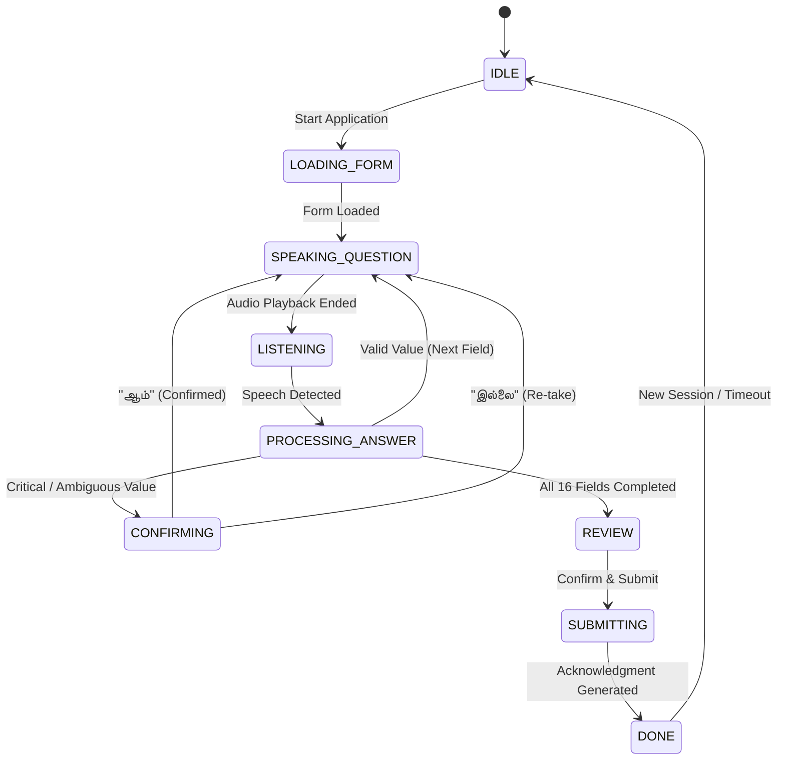

# Solli (சொல்லி) — Product Requirements Document (PRD)

> **Civic Voice-First Pension & Web Form Assistant**  
> **Target Scheme**: Indira Gandhi National Old Age Pension Scheme (IGNOAPS) / தமிழ்நாடு அரசு · சமூக நலத்துறை  
> **Version**: 2.5.0 · **Status**: Production Ready · **Test Coverage**: 436 / 436 Tests Passing (100%)

---

## 1. Executive Summary & Vision

**Solli** (Tamil for *"Speak it"* or *"Tell me"*) is a voice-first civic kiosk web application designed to help elderly, rural, and semi-literate citizens in Tamil Nadu independently complete government welfare applications—specifically the **Old-Age Pension Scheme (IGNOAPS)**—in their spoken mother tongue.

### Problem Statement
Rural elderly citizens face systemic barriers accessing civic benefits:
1. **Intimidating Digital Interfaces**: Traditional web forms rely on dense desktop tables, tiny inputs, and English jargon.
2. **Exploitative Middlemen**: Applicants frequently pay predatory service fees at unauthorized cyber cafés.
3. **Complex Field Formatting**: Validating dates of birth, 12-digit Aadhaar numbers, and Tamil honorifics without visual assistance is error-prone.

### Core Solution
Solli transforms civic form-filling into an ambient dialogue:
- The kiosk **speaks questions in natural Tamil** (or Indian English).
- A real-time **12-bar acoustic visualizer** provides visual reassurance that the applicant is being heard.
- The applicant speaks naturally; Solli **extracts, normalizes, and groups digits** (e.g. Aadhaar 4-4-4, Mobile 5-5).
- A **civic registry ledger** updates live on the screen.
- Upon completion, the kiosk produces a **form-ready verification receipt**.

---

## 2. User Personas

| Persona | Role | Primary Needs | Key Pain Points |
|---|---|---|---|
| **Elderly Applicant (Thatha / Paati)** | Primary Citizen (60–85+ yrs) | Simple spoken interaction in colloquial Tamil; large readable text; audio reassurance. | Cataracts/low vision, trembling hands, unfamiliar with typing or keyboards. |
| **e-Sevai / VAO Operator** | Kiosk Supervisor | Quick manual overrides, session reset, high-contrast mode, font size adjustment. | Long queues, privacy management between applicants, noisy room interference. |

---

## 3. Technology Architecture

```
┌────────────────────────────────────────────────────────────────────────┐
│                          Solli Client (React 19)                       │
│  ┌───────────────────────┐  ┌────────────────────────────────────────┐ │
│  │   Civic Ledger (62%)  │  │        Voice Companion (38%)           │ │
│  │  - 16 Verified Rows   │  │  - 12-Bar Acoustic Telemetry Visualizer │ │
│  │  - Live Status Tags   │  │  - Localized Question Audio Prompt     │ │
│  │  - Instant Search     │  │  - One-Tap Yes / No Confirmation Card  │ │
│  └───────────────────────┘  └────────────────────────────────────────┘ │
└────────────────────────────────────┬───────────────────────────────────┘
                                     │ REST / WebSocket
┌────────────────────────────────────▼───────────────────────────────────┐
│                       Solli Server (Express 5.1)                       │
│  ┌─────────────────────────┐  ┌──────────────────────────────────────┐ │
│  │  Gnani.ai Speech Stack  │  │      Entity & Rule Extractors        │ │
│  │  - STT: timbre-v3.0     │  │  - Tamil Spoken Numbers Lexicon      │ │
│  │  - TTS: Chetana/Kalpana │  │  - Structured Digit Grouper (Aadhaar)│ │
│  │  - Audio Cache Queue    │  │  - Yes/No Contrast Resolver          │ │
│  └─────────────────────────┘  └──────────────────────────────────────┘ │
│  ┌─────────────────────────┐  ┌──────────────────────────────────────┐ │
│  │ Web Form Dynamic Engine │  │     Safety & PDF Receipt Engine      │ │
│  │  - Google Form Scanner  │  │  - 60s Inactivity Auto-Purge        │ │
│  │  - Auto-Fill Pipeline   │  │  - Zero PII Storage (No Cookies)     │ │
│  └─────────────────────────┘  └──────────────────────────────────────┘ │
└────────────────────────────────────────────────────────────────────────┘
```

### Stack Breakdown
- **Frontend**: React 19, Vite, Tailwind CSS v4 (`@theme`), Shadcn/UI (18 accessible components), Lucide Icons.
- **Backend**: Node.js 20+, Express 5.1, `pdf-lib` for acknowledgment receipts.
- **Voice Stack**: Gnani.ai STT (`ta-IN`, `en-IN`), Gnani.ai TTS (`timbre-v3.0`), Web Speech API fallback.
- **Color Palette**: Ember Obsidian Dark Theme:
  - **Primary Brand Accent**: `#FF6D29` (Ember Orange)
  - **Structural Rule**: `#453027` (Umber Bronze)
  - **Canvas Base**: `#161316` (Deep Obsidian)
  - **Secondary Text**: `#BABABA` (Ash Silver)
  - **Foreground Text**: `#FFFFFF` (Pure White)
- **Typography**: `Geist` (Sans UI & Display) + `Geist Mono` (Tabular Telemetry Numbers).

---

## 4. Bilingual Form Schema (16 IGNOAPS Fields)

| # | Field ID | Field Name (Tamil / English) | Type | Validation / Formatting |
|---|---|---|---|---|
| 1 | `applicant_name` | விண்ணப்பதாரர் பெயர் / Applicant Name | Text | Clean name extraction without prefixes |
| 2 | `parent_spouse_name` | தந்தை / கணவர் பெயர் / Parent/Spouse | Text | Relative relation normalization |
| 3 | `gender` | பாலினம் / Gender | Choice | ஆண் (Male), பெண் (Female), மூன்றாம் பாலினம் |
| 4 | `age` | வயது / Age | Number | $\ge 60$ for old-age eligibility |
| 5 | `dob` | பிறந்த தேதி / Date of Birth | Date | Standardized `DD/MM/YYYY` |
| 6 | `marital_status` | திருமண நிலை / Marital Status | Choice | Married, Widowed, Deserted, Unmarried |
| 7 | `address` | முகவரி / Residential Address | Text | Door number, street, locality |
| 8 | `village` | கிராமம் / Village | Text | Local revenue village or municipal ward |
| 9 | `taluk` | வட்டம் / Taluk | Text | Administrative taluk |
| 10 | `district` | மாவட்டம் / District | Text | Matched across 38 Tamil Nadu districts |
| 11 | `pincode` | அஞ்சல் குறியீட்டு எண் / Pin Code | Digits | 6 digits, Tamil Nadu prefix (`6xxxxx`) |
| 12 | `aadhaar_number` | ஆதார் எண் / Aadhaar Number | Digits | 12 digits, grouped into `4-4-4` |
| 13 | `ration_card` | குடும்ப அட்டை எண் / Ration Card | Code | Alphanumeric (e.g. `05/G/0123456`) |
| 14 | `phone` | தொலைபேசி எண் / Mobile Number | Digits | 10 digits, grouped `5-5` or `3-3-4` |
| 15 | `bank_account` | வங்கி கணக்கு எண் / Bank Account | Digits | 9 to 18 digits, grouped into chunks of 4 |
| 16 | `ifsc_code` | IFSC குறியீடு / Bank IFSC Code | Code | 11 chars: 4 letters + `0` + 6 alphanumerics |

---

## 5. Conversational State Machine (FSM)



### Dialogue Escalation & Retries
- **Attempt 1 (Silence/Noise)**: Localized gentle nudge (`"தயவுசெய்து உங்கள் பதிலைச் சொல்லுங்கள்"`).
- **Attempt 2 (Unclear)**: Concrete conversational example (`"உதாரணமாக, பொள்ளாச்சி என்று சொல்லுங்கள்"`).
- **Attempt 3 (Repeated Failure)**: Marks field as `needsOperatorHelp` and smoothly transitions to next question without locking the kiosk.

### Voice Commands
- **"Repeat" (`மறுபடி`)**: Replays the question audio.
- **"Later" (`பிறகு`)**: Postpones current field to the end of the queue.
- **"Skip" (`தவிர்`)**: Safely skips optional questions.
- **"Back" (`முந்தையது`)**: Returns to edit the preceding field.
- **"Restart" (`மீண்டும்`)**: Instantly resets session state.

---

## 6. Entity Extraction & Normalization Engine

### A. Spoken Tamil Numbers Lexicon
- Single digits: `ஒன்று` (1), `இரண்டு` (2), `மூன்று` (3), ..., `ஒன்பது` (9).
- Colloquial & Romanized Tamil: `"onnu"`, `"rendu"`, `"pathu"`, `"nooru"`, `"aayiram"`.
- Compounding: `"இருபத்தி ஐந்து"` $\rightarrow$ `25`; `"தொள்ளாயிரத்து ஐம்பது"` $\rightarrow$ `950`.

### B. Structured Digit Chunking & Readback
- **Mobile Numbers**: Chunked into 5+5 (`98401, 23456`) with audible acoustic comma pauses.
- **Aadhaar Numbers**: Formatted into 4+4+4 (`XXXX, XXXX, 1234`).
- **Bank Accounts**: Segmented into 4-digit groups.

### C. Contrast Resolution
- Intelligently parses mixed utterances like *"sari, aana illai"* (yes, but no) by flagging `needsConfirmation: true` and prompting explicit verification.

---

## 7. Dynamic Web Form Scanner & Auto-Fill

- Ingests external HTML forms or Google Forms.
- Maps inputs, selects, and textareas into Solli's conversational pipeline.
- Automatically serves built-in schemas offline if network drops.

---

## 8. Complete Shadcn/UI Suite

All 18 components reside in [`client/src/components/ui/`](file:///c:/Users/Star/developer/SOLLI/client/src/components/ui/):
1. **Button** (`button.jsx`): Primary ember, umber secondary, ghost, outline.
2. **Card** (`card.jsx`): Header, title, description, content, footer.
3. **Badge** (`badge.jsx`): Status tags (Done, Pending, Active).
4. **Input** (`input.jsx`): Manual fallback text entry.
5. **Label** (`label.jsx`): Semantic accessible labels.
6. **Table** (`table.jsx`): Civic ledger view for all form rows.
7. **Dialog** (`dialog.jsx`): Modal confirmations and countdown warnings.
8. **Sheet** (`sheet.jsx`): Sliding operator assistance sheet.
9. **Collapsible** (`collapsible.jsx`): Collapsible metadata tiles.
10. **Tooltip** (`tooltip.jsx`): Hover/touch guidance on table actions.
11. **Switch** (`switch.jsx`): Tactile kiosk setting switches.
12. **Slider** (`slider.jsx`): Font scale & volume controls.
13. **Progress** (`progress.jsx`): Application completion meter.
14. **Separator** (`separator.jsx`): Clean hairline rule dividers.
15. **Tabs** (`tabs.jsx`): Multi-section category filtering.
16. **Avatar** (`avatar.jsx`): Applicant & operator glyphs.
17. **Skeleton** (`skeleton.jsx`): Non-flickering shimmer loaders.
18. **Alert** (`alert.jsx`): Contextual warnings and error banners.

---

## 9. Kiosk Safety, Privacy & Accessibility

- **Zero-PII Storage**: Absolutely no applicant data stored in `localStorage`, `sessionStorage`, or cookies.
- **60s Inactivity Auto-Reset**: 10-second warning countdown before total memory wipe to protect user privacy in public spaces.
- **Operator Drawer**: Magnified font sizes (Small / Normal / Large), high-contrast mode, and audio mute.
- **Printable Acknowledgment**: Generates official bilingual PDF receipt with stamp and application reference number.

---

## 10. REST API Specification

| Endpoint | Method | Purpose |
|---|---|---|
| `/api/form/:id` | `GET` | Retrieve schema (e.g., `pension`) |
| `/api/form/:id/answer` | `POST` | Extract and normalize spoken answer |
| `/api/form/:id/next` | `POST` | Get next sequential question |
| `/api/form/:id/command` | `POST` | Handle voice navigation commands |
| `/api/form/:id/submit` | `POST` | Final application submission |
| `/api/tts` | `POST` | Synthesize Indic Tamil/English audio |
| `/api/stt` | `POST` | Transcribe multipart audio blob |

---

## 11. Verification & Quality Assurance

- **Unit & Integration Tests**: 436 tests across 61 suites passing with **100% pass rate**.
- **Production Client Build**: Compiles cleanly with Vite in under **1.6 seconds**.

