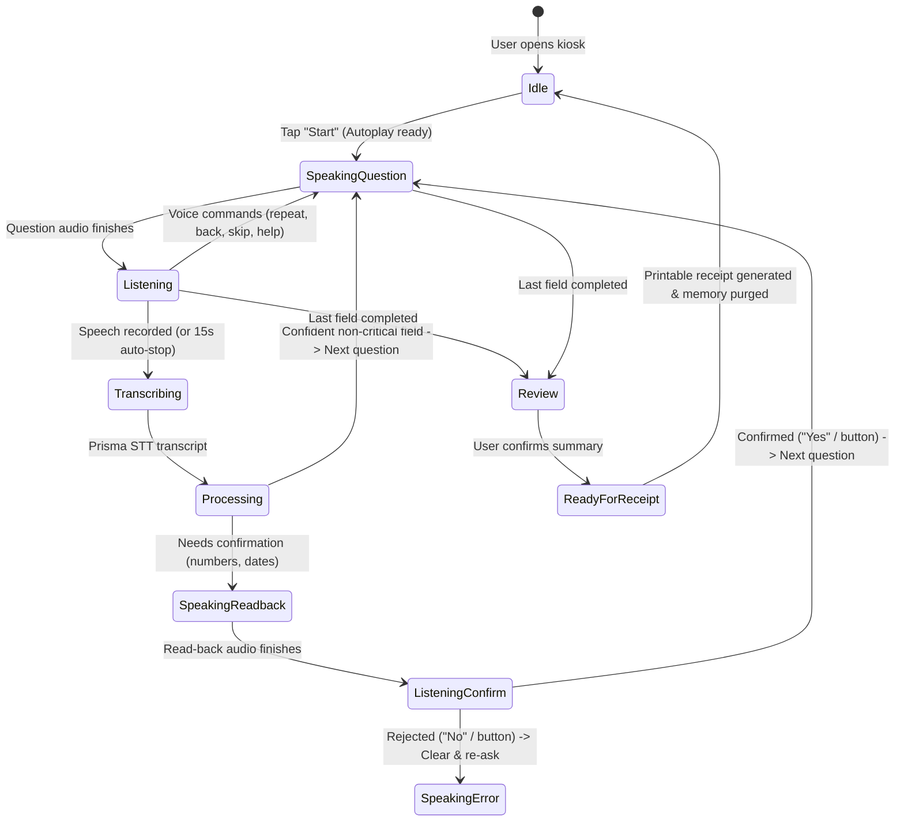
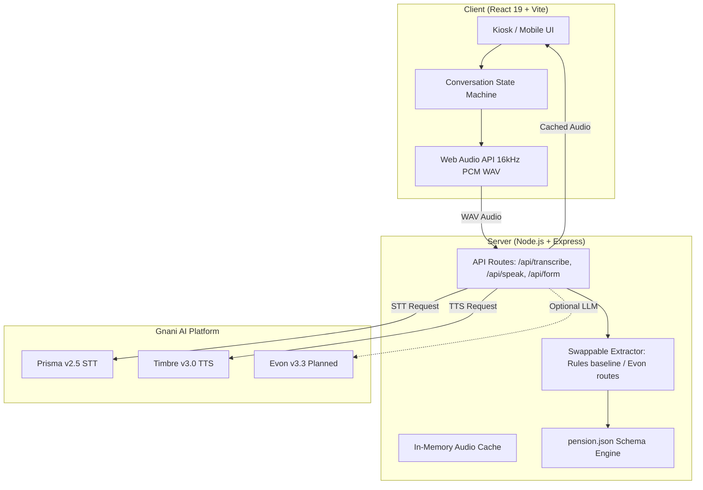

<div align="center">

# Solli / சொல்லி

**Just say it. We'll fill the form.**

A multilingual voice assistant that helps people who find forms hard to read or type fill them in by speaking in their own language.

[](https://nodejs.org)
[](https://react.dev)
[](#disclaimer)
[](#contest-and-credits)
[](#license)

</div>

---

### Quick Links

- **Pitch (PDF):** `PITCH.pdf` (coming soon)
- **Demo Video:** [Coming soon / Paste link]
- **LinkedIn Post:** [Coming soon / Paste link]
- **Live Demo:** [Coming soon / Paste link]

---

## Table of Contents

- [The problem](#the-problem)
- [The solution](#the-solution)
- [Who it is for](#who-it-is-for)
- [How it works](#how-it-works)
- [Features](#features)
- [Languages](#languages)
- [Built on Gnani AI](#built-on-gnani-ai)
- [Architecture](#architecture)
- [Getting started](#getting-started)
- [Environment variables](#environment-variables)
- [Usage guide](#usage-guide)
- [Testing](#testing)
- [Privacy and security](#privacy-and-security)
- [Honest limitations](#honest-limitations)
- [Roadmap](#roadmap)
- [Contest and credits](#contest-and-credits)
- [Contributing](#contributing)
- [License](#license)
- [Disclaimer](#disclaimer)

---

<!-- TODO: Hero screenshot or GIF (capture from demo mode and place in docs/screenshots/01-language-screen.png) -->
> [!NOTE]
> Application screenshots are being captured with synthetic demo data. See [docs/screenshots/README.md](docs/screenshots/README.md) for the 5-screen capture checklist.

---

## The problem

Many eligible applicants miss welfare pensions, scholarships, and public assistance because of paperwork rather than eligibility. Forms are long, written in formal administrative phrasing, and rarely offered in the dialect spoken at home. Many applicants are elderly, have low vision, or cannot read and type digital text. They are forced to depend on unofficial intermediaries who charge fees, make typing mistakes, and occasionally expose applicants to fraud. Most existing digital form tools support only one or two languages, leaving millions excluded from benefits they qualify for.

## The solution

Solli turns welfare form filling into a calm, spoken conversation in the applicant's own language. The applicant selects their language, listens to each question spoken aloud in a natural regional voice, and replies naturally using conversational or code-mixed speech. Solli extracts clean values, verifies sensitive identifiers through chunked read-backs, and presents a complete review summary with zero typing required. Answers live purely in volatile memory during the active session and are never saved to a database or browser storage.

---

## Who it is for

- **Organisations (The Customer):** Common Service Centres (CSCs), e-Sevai kendras, gram panchayat helpdesks, ward offices, bank branches, and welfare NGOs that assist dozens of applicants every day.
- **Applicants (The End User):** Elderly citizens, rural residents, first-time welfare applicants, and anyone who finds typing or reading formal administrative prose difficult.
- **Operators (The Supervisor):** Helpdesk staff who supervise kiosks, assist when users are unsure, make manual corrections via touch or voice, and print final summaries.

---

## How it works

1. **Choose a language:** The applicant picks from 10 Indian languages (or Tanglish). Screen text and spoken voice switch together.
2. **Solli asks:** Each question is spoken aloud in a natural, friendly regional voice.
3. **The person answers:** The applicant speaks freely, including code-mixed answers such as Tamil-English or Hindi-English.
4. **Solli understands:** Speech becomes text, and text becomes clean structured field values (names, dates, phone numbers).
5. **Solli confirms:** Important names, dates, and long numbers are read back in small rhythmic groups. The applicant confirms by voice or taps on-screen buttons.
6. **The person controls the flow:** Voice commands like "repeat", "go back", "skip", "I don't know", or "change the village" steer the session.
7. **Review:** A final review ledger lists every field with a status badge; any field can be edited by voice or by tapping.
8. **Finish:** The session generates a printable receipt summary and safely clears all applicant data from volatile memory.



---

## Features

### Voice and language
- Speech-to-text for recorded answers using Gnani Prisma v2.5.
- Spoken questions and read-backs in regional voices using Gnani Timbre v3.0.
- Dynamic language and voice switching across 10 Indian languages.
- Code-mixed speech handling for natural conversational phrasing (e.g., Tamil-English).
- Spoken number understanding for digits, number words, repetition patterns ("double five"), and scales (lakh, crore).
- Flexible date understanding supporting spoken months, calendar years, and spoken self-corrections.

### Accuracy and trust
- Chunked read-back with natural rhythmic pauses (phone 5+5, Aadhaar 4+4+4, bank account 4-digit groups).
- Dual-mode confirmation: voice ("ஆம் / இல்லை", "yes / no") or prominent on-screen touch buttons.
- Silence or ambiguous speech is never treated as affirmative consent.
- Finite retries: after 2 failed attempts, fields defer gracefully with "Let us come back to this" and flag for operator review.
- Strict format validation for phone numbers, dates, identifiers, and names (syntax check only; no database lookup).

### Control
- Voice commands: `repeat`, `skip` (optional fields only), `dont_know`, `back`, `change_field`, `help`, `operator`, `stop`, `start_over`.
- Voice and tap editing on the final review ledger.
- Destructive safety guard: `start_over` always requires explicit modal confirmation before clearing data.

### Kiosk and accessibility
- High-contrast visual mode and scalable typography for low-vision applicants.
- Operator control strip: mute voice, restart session, typed test mode, and manual field editing.
- Live audio level display and animated telemetry equalizer during microphone listening.
- Automatic inactivity timeout that purges in-memory session data if an applicant walks away.

### Privacy
- Zero persistent storage: no applicant data is saved to a database, cookies, or browser storage.
- In-memory session lifecycle: answers exist only in volatile RAM during the session.
- Sensitive values are masked on screen (`XXXX 1234`).
- Server-side credentials: API keys never reach the client browser.

---

## Languages

| Language | Script / Native Name | Screen Text | Voice Synthesis | Speech Understanding Tested |
|---|---|---|---|---|
| **Tamil** | தமிழ் | Available | Available (Shivani) | Thoroughly tested (dev & held-out suites) |
| **English** | English (India) | Available | Available (Shivani) | Thoroughly tested (dev & held-out suites) |
| **Tanglish** | Tanglish (தமிழ் + Eng) | Available | Available (Shivani) | Thoroughly tested (code-mixed rules) |
| **Hindi** | हिन्दी | Available | Available (Shivani) | Preview (untested with real speech) |
| **Telugu** | తెలుగు | Available | Available (Shivani) | Preview (untested with real speech) |
| **Kannada** | ಕನ್ನಡ | Available | Available (Shivani) | Preview (untested with real speech) |
| **Malayalam** | മലയാളം | Available | Available (Shivani) | Preview (untested with real speech) |
| **Marathi** | मराठी | Available | Available (Shivani) | Preview (untested with real speech) |
| **Bengali** | বাংলা | Available | Available (Shivani) | Preview (untested with real speech) |
| **Gujarati** | ગુજરાતી | Available | Available (Shivani) | Preview (untested with real speech) |
| **Punjabi** | ਪੰਜਾਬੀ | Available | Available (Shivani) | Preview (untested with real speech) |

> [!NOTE]
> **Honest Testing Note:** Solli's voice and screen text are available in 10 Indian languages. Speech understanding rules, number parsing tables, and automated test fixtures were built and tested thoroughly in **Tamil and English (including Tanglish)**. Other languages are an early UI and voice synthesis preview, and speech understanding accuracy has not been tested with native speakers.

---

## Built on Gnani AI

| Model | Role in Solli | Status in Final Demo |
|---|---|---|
| **Prisma v2.5** | Speech-to-text: transcribes recorded applicant voice answers (`POST /stt/v3`) | Running in live demo (fallback to fake mock transcripts if offline) |
| **Timbre v3.0** | Text-to-speech: speaks questions and chunked read-backs (`POST /api/v1/tts/inference`) | Running in live demo (with server caching and split read-back) |
| **Evon v3.3** | Reasoning LLM: field extraction and ambiguity resolution | Rule-based extraction in the demo, Evon integration prepared and planned (`server/llm/evonApi.js`, `server/llm/evonSelfHost.js`) |

> **Credential Security:** The Gnani API key stays strictly on the Express server (`server/.env`) and is never transmitted to or exposed in the browser.

---

## Architecture



### Folder Structure (2 levels)

```text
SOLLI/
├── client/                     # Frontend client application (React 19 + Vite)
│   ├── public/                 # Static assets, favicon, and brand icons
│   ├── scripts/                # Client utility scripts
│   ├── src/                    # Source code (pages, components, state machine, styles)
│   ├── tests/                  # Frontend kiosk security & safety tests (18 tests)
│   └── package.json            # Client dependencies and npm scripts
├── server/                     # Backend API server (Node.js + Express)
│   ├── forms/                  # Declarative form schemas (pension.json)
│   ├── llm/                    # Field extractors, normalization, commands, and Evon drivers
│   ├── scripts/                # Evaluation & smoke test runners (extract, commands, smoke)
│   ├── tests/                  # Backend unit and integration test suites (418 tests)
│   └── package.json            # Server dependencies and npm scripts
├── docs/                       # Technical specs, evaluation reports, and architecture guides
│   ├── results/                # Baseline and evaluation run records
│   ├── screenshots/            # Application screenshot assets and capture guide
│   └── INDEX.md                # Master directory linking to all documentation
├── samples/                    # Fake audio and synthetic sample fixtures
├── tests/                      # Stratified test fixture datasets (dev, heldout, fake applicants)
├── package.json                # Root package workspace scripts
└── README.md                   # Project documentation and submission pitch
```

### Design Decisions

1. **Key stays server-side:** All calls to Gnani AI route through `server/gnani.js`. The client never handles credentials.
2. **Zero persistent storage:** No database, browser storage, or cookies. Data lives in volatile memory during the active session only.
3. **Rules plus swappable LLM:** Deterministic rule-based extraction baseline runs in under 1 ms with 0 credit cost; Evon LLM routes are swappable via `EVON_PROVIDER` with an automatic fallback guard.
4. **Form definition in JSON:** The entire form schema (`server/forms/pension.json`) is declarative. Adding fields or languages does not require altering core state machine code.

---

## Getting started

### Prerequisites

- **Node.js:** Node.js 18+ (Node.js 20+ recommended)
- **Package Manager:** npm (bundled with Node)
- **Gnani AI API Key:** A valid API key from [app.gnani.ai](https://app.gnani.ai) (for live speech features)

### Installation

1. **Clone the repository:**
   ```bash
   git clone <repo-url>
   cd SOLLI
   ```

2. **Install dependencies:**
   ```bash
   npm --prefix server install
   npm --prefix client install
   ```

3. **Configure environment variables:**
   ```bash
   cp server/.env.example server/.env
   ```
   Open `server/.env` and add your Gnani API key:
   ```env
   GNANI_API_KEY=your_gnani_api_key_here
   PORT=5000
   ```

4. **Start the server (Terminal 1):**
   ```bash
   npm --prefix server run dev
   ```

5. **Start the client (Terminal 2):**
   ```bash
   npm --prefix client run dev
   ```

6. **Open the application:**
   Navigate to `http://localhost:5173`. The client automatically proxies `/api` requests to the server on port 5000.

> [!TIP]
> **HTTPS for Phone Testing:** Mobile browsers require a secure origin (HTTPS or localhost) to allow microphone recording. When testing on a physical phone over local Wi-Fi, use a secure tunnel tool (e.g. `cloudflared`, `ngrok`, or `localtunnel`) to access the client over HTTPS.

> [!NOTE]
> **Demo Mode:** To test the application without consuming live Gnani API credits or using a microphone, start the client with:
> ```bash
> VITE_DEMO_MODE=true npm --prefix client run dev
> ```
> This enables on-screen demo banners, pauses the inactivity timer, and allows typing answers via **Typed Test Mode**.

---

## Environment variables

Configured in `server/.env` (derived from `server/.env.example`):

| Variable | Required | Description | Example |
|---|---|---|---|
| `GNANI_API_KEY` | Yes (for live voice) | API key from app.gnani.ai for Prisma STT & Timbre TTS | `vach_live_sample_key...` |
| `PORT` | Optional (default: 5000) | Port for the Express backend server | `5000` |
| `EVON_PROVIDER` | Optional (default: rules) | Extraction driver: `rules`, `evon-api`, or `evon-selfhost` | `rules` |
| `EVON_API_URL` | Optional | API endpoint if using closed beta Evon API | `https://api.vachana.ai/v1/chat/completions` |
| `EVON_API_KEY` | Optional | Dedicated API key for Evon if distinct from GNANI_API_KEY | `evon_beta_sample_key...` |
| `EVON_SELFHOST_URL` | Optional | Base URL for self-hosted OpenAI-compatible Evon instance | `http://localhost:8000/v1` |

---

## Usage guide

### For applicants (what to say)
- **Names:** Speak your full name or spell letters: *"K. Muthu"*, *"M U T H U"*.
- **Dates of birth:** Speak naturally with month and year: *"May 5, 1958"*, *"1958 la May 5"*.
- **Numbers:** Speak digits individually, in pairs, or in words: *"98401 23450"*, *"double nine four zero"*.
- **Confirmations:** Say *"ஆம் / Yes"* to confirm, or *"இல்லை / No"* to re-take.

### For operators
- **Operator Bar:** Located at the top of `/app`. Allows instant language switching, muting voice synthesis, toggling typed test mode, adjusting contrast/font size, or restarting the session.
- **Manual Corrections:** Tap any field on the review screen or use the on-screen buttons to correct values without re-speaking the entire form.

### Voice commands reference

| Command | English Examples | Tamil Examples (Roman & Script) | Safe Action |
|---|---|---|---|
| `repeat` | "repeat", "say again", "once more" | "thirumba sollunga", "meendum", "மீண்டும்" | Replays question or read-back. Never counts as a failed attempt. |
| `skip` | "skip", "next question", "pass" | "aduthadhu", "vittudunga", "தவிர்" | Allowed on optional fields only (`nominee`). Refused on required fields. |
| `dont_know` | "I don't know", "not sure" | "theriyadhu", "puriyala", "தெரியாது" | Marks field `needsOperatorHelp`. Never invents or guesses data. |
| `back` | "back", "go back", "previous" | "munnadi ponga", "முன்னாடி போங்க" | Re-asks previous spoken field while preserving visible answers. |
| `change_field` | "change the village", "change phone" | "ooru maathunga", "மாத்துங்க" | Fuzzy matches target field; preserves old value until replacement confirmed. |
| `help` | "help", "help me", "explain" | "udhavi venum", "vilakkam", "உதவி" | Speaks field's `helpPrompt` then resumes listening. |
| `operator` | "operator", "call operator", "staff" | "adhigaari venum", "ஆபரேட்டர்", "பணியாளர்" | Pauses loop, shows large "Operator Needed" banner, awaits resume tap. |
| `stop` | "stop", "pause", "hold on", "wait" | "niruthunga", "நிறுத்து", "வெயிட்" | Releases microphone, displays "Conversation Paused" overlay with Resume button. |
| `start_over` | "start over", "restart", "delete all" | "modhalla irundhu", "முதலில் இருந்து ஆரம்பி" | **High risk:** Always prompts modal confirmation before clearing data. |

---

## Testing

Solli includes automated test suites covering client kiosk safety, the state machine, API endpoints, number parsers, and command classifiers.

### Running tests

- **Run all automated tests (client + server):**
  ```bash
  npm test
  ```
  *Executes 436 tests across 61 test suites (18 client + 418 server tests).*

- **Run client tests only:**
  ```bash
  npm --prefix client test
  ```

- **Run server tests only:**
  ```bash
  npm --prefix server test
  ```

- **Run field extraction evaluation:**
  ```bash
  npm --prefix server run extract:eval -- --set dev
  npm --prefix server run extract:eval -- --set heldout
  ```

- **Run voice command safety evaluation:**
  ```bash
  npm --prefix server run commands:eval -- --set dev
  npm --prefix server run commands:eval -- --set heldout
  ```

### Results

| Benchmark / Evaluation Suite | Sample Size | Measured Pass Rate / Accuracy | Status |
|---|---|---|---|
| **Automated Test Suite (Full Stack)** | 436 tests (61 suites) | **100%** (436 / 436 passed) | Verified (`npm test`) |
| **Field Extraction (Dev Set)** | 53 synthetic items | **100.0%** (53 / 53) | Verified (`extract:eval`) |
| **Field Extraction (Strict Held-Out)** | 25 synthetic items | **96.0%** (24 / 25) | Verified (`extract:eval`, 1 fixture artifact) |
| **Command Classification (Dev Set)** | 28 synthetic items | **100.0%** (28 / 28) | Verified (`commands:eval`) |
| **Command False Positive Rate** | 21 negative cases | **0.0%** FPR | Verified (0 data corruption) |
| **Live Microphone Acoustic Accuracy (Quiet)** | N/A | **Not yet measured** | Planned for live field pilot |
| **Live Microphone Acoustic Accuracy (Noisy)** | N/A | **Not yet measured** | Planned for live field pilot |

> [!IMPORTANT]
> **Code Verification vs. Acoustic Accuracy:** Automated tests and evaluation scripts verify software logic, regular expressions, number parsing, state transitions, and zero-storage security constraints using synthetic text fixtures. They do not measure live acoustic microphone accuracy across varied village accents and ambient background noise.

---

## Privacy and security

- **No persistent data storage:** Answers exist exclusively in temporary memory while the form is being completed. No database, server disk storage, or cookies are used.
- **Zero browser storage of answers:** Client tests (`client/tests/frontendKioskSafety.test.js`) enforce that no form data or transcripts are written to browser storage.
- **Masked sensitive values:** Sensitive numbers (Aadhaar, phone number, bank account) display only their last 4 digits on screen (`XXXX 1234`).
- **Inactivity wipe:** The session timer automatically resets and purges in-memory answers after prolonged inactivity.
- **Credentials protected:** The Gnani API key stays on the backend server and is never sent to the browser.
- **Synthetic demo data:** All automated tests, sample fixtures, and video demonstrations use fake data only.
- **Format checking only:** Solli checks whether numbers and dates match expected lengths and formats. It does not verify records against live government databases.

---

## Honest limitations

- **Student prototype:** Solli is an independent student prototype built for the Great Indian AI Internship Challenge. It is not an official government service.
- **No official submissions:** Solli assists with collecting and reviewing information; it does not submit applications to any government portal.
- **Acoustic accuracy unmeasured:** Speech recognition accuracy under varying real-world background noise and rural dialect conditions has not yet been quantitatively measured.
- **Language depth:** Speech understanding rules and test suites were built and verified for Tamil and English (including Tanglish). Support for other regional languages is currently an early UI and voice synthesis preview.
- **Extraction engine:** Answer extraction currently uses a rule-based engine. Gnani Evon v3.3 integration is architected and planned.
- **Synthetic data only:** Demos and automated tests use fake sample personas.

---

## Roadmap

- [Planned] **Browser Extension:** A companion browser extension that scans existing web forms on public portals and allows applicants to fill them by voice, featuring a side-by-side verification table and no automated submission.
- [Planned] **Printable PDF Output:** Direct generation of standard blank-overlay application PDFs from confirmed in-memory field values.
- [Planned] **Acoustic & Dialect Verification:** Rigorous testing and tuning across regional dialects (Kongu, Madurai, Nellai) and additional Indian languages.
- [Planned] **Multi-Form Expansion:** Additional public welfare form schemas (scholarships, rural housing, disability assistance).

---

## Contest and credits

- **Contest:** Built for the **Great Indian AI Internship Challenge**, organized by **Gnani AI**.
- **Models:** Powered by Gnani AI's **Prisma v2.5** (STT) and **Timbre v3.0** (TTS), with **Evon v3.3** integration planned.
- **Hashtags:** `#GnaniAI #GreatIndianAIInternshipChallenge`
- **Author:** Built by **Dhanushkumar G**, student at [COLLEGE NAME].

---

## Contributing

Feedback and contributions are welcome. Please open an issue to discuss proposed enhancements, keep pull requests focused, and ensure all tests pass with `npm test` before submitting.

---

## License

License: [TBD] *(A standard open-source license will be selected upon final submission)*.

---

## Disclaimer

Solli is an independent student prototype created solely for the Great Indian AI Internship Challenge. It is not affiliated with, endorsed by, or operated by any government department, public welfare agency, or official portal. Solli does not submit applications, make welfare eligibility determinations, or verify legal identity records. All demonstrations, screenshots, and test suites use synthetic fake data only.
