# Solli Conversation Loop Specification

> **Phase:** Phase 12: Voice Commands, Field Targeting & In-Answer Corrections  
> **Status:** Built and verified with unit tests and live speech verification.

---

## 1. State Diagram (Mermaid)

```mermaid
stateDiagram-v2
    [*] --> Idle
    Idle --> LoadingForm: User taps "Start"
    LoadingForm --> SpeakingQuestion: Form definition loaded
    LoadingForm --> Error: Network / server failure

    SpeakingQuestion --> Listening: Question audio completes (or skipped if muted)
    SpeakingQuestion --> Idle: User taps Stop / Restart

    Listening --> Transcribing: Audio recorded (tap stop or 15s auto-stop)
    Listening --> Processing: Typed answer submitted (Dev Typed Mode)
    Listening --> SpeakingQuestion: Command: repeat / back / help
    Listening --> SpeakingQuestion: Command: skip (optional field)
    Listening --> SpeakingQuestion: Command: change_field (target resolved)
    Listening --> Paused: Command: stop
    Listening --> OperatorPaused: Command: operator
    Listening --> ConfirmStartOver: Command: start_over
    Listening --> Review: User skips final field
    Listening --> Idle: User taps Stop / Restart

    Transcribing --> Processing: Prisma STT returns transcript
    Transcribing --> SpeakingHelp: Silence / noise detected (Attempt 1)
    Transcribing --> SpeakingError: Silence detected (Attempt >= 2)
    Transcribing --> Error: Rate limit (429) or network failure

    Processing --> SpeakingReadback: Answer valid & shouldConfirm=true
    Processing --> SpeakingQuestion: Answer valid & shouldConfirm=false -> next field
    Processing --> Review: Answer valid & shouldConfirm=false -> final field
    Processing --> SpeakingHelp: Silence or partial number capture
    Processing --> SpeakingError: Validation error (Attempt 1..2)
    Processing --> Paused: Command detected in transcript: stop
    Processing --> OperatorPaused: Command detected: operator
    Processing --> ConfirmStartOver: Command detected: start_over
    Processing --> Error: Server / quota error

    SpeakingReadback --> ListeningConfirm: Read-back audio completes (or skipped)
    SpeakingReadback --> Idle: User taps Stop / Restart

    ListeningConfirm --> ProcessingConfirm: Audio recorded (auto-stop 6s) or typed submit
    ListeningConfirm --> SpeakingQuestion: On-screen Yes tapped -> advance next field
    ListeningConfirm --> Review: On-screen Yes tapped -> advance to review
    ListeningConfirm --> SpeakingError: On-screen No tapped -> clear value & re-ask
    ListeningConfirm --> SpeakingQuestion: Command: repeat / help
    ListeningConfirm --> OperatorPaused: Command: operator
    ListeningConfirm --> Idle: User taps Stop / Restart

    ProcessingConfirm --> SpeakingQuestion: Answer "yes" -> confirmed, advance next field
    ProcessingConfirm --> Review: Answer "yes" -> confirmed, final field or edit complete
    ProcessingConfirm --> SpeakingError: Answer "no" -> clear value & re-ask same question
    ProcessingConfirm --> SpeakingReadback: Answer "unclear" (<3 rounds) -> re-prompt with Yes/No buttons
    ProcessingConfirm --> SpeakingError: Answer "unclear" (>=3 rounds) -> mark needsOperatorHelp & advance
    ProcessingConfirm --> Error: Server failure

    SpeakingHelp --> Listening: Help prompt audio completes -> listen again
    SpeakingError --> Listening: Re-ask prompt completes -> retry question
    SpeakingError --> SpeakingQuestion: "Let us come back to this" completes -> advance to next field
    SpeakingError --> Review: "Let us come back to this" completes -> final field

    Review --> SpeakingQuestion: User taps "Edit" or speaks change on review
    Review --> ReadyForPdf: User taps "Yes, everything is correct"
    Review --> ConfirmStartOver: Command / tap: start_over
    Review --> Idle: User taps "Start New"

    Paused --> Listening: User taps "Resume"
    OperatorPaused --> Listening: Operator taps "Resume"

    ConfirmStartOver --> Idle: Confirmed YES ("Delete everything")
    ConfirmStartOver --> Listening: Cancelled NO (Keep answers, resume)
    ConfirmStartOver --> Review: Cancelled NO from review (Keep answers)

    ReadyForPdf --> Idle: User taps "Start New"
    Error --> Idle: User taps "Restart"
```

---

## 2. Explicit Transition Table

| Current State (`FROM`) | Trigger Event (`EVENT`) | Next State (`TO`) | Description |
|---|---|---|---|
| `idle` | `START` | `loadingForm` | User taps "தொடங்கு / Start" button (satisfies browser autoplay policy). |
| `loadingForm` | `FORM_LOADED` | `speakingQuestion` | Form definition retrieved from `GET /api/form/pension`. First spoken field selected. |
| `loadingForm` | `FAIL` | `error` | Form loading failure. |
| `speakingQuestion` | `AUDIO_ENDED` / `SKIP_AUDIO` | `listening` | Question audio completes playback (or skipped when `voiceMuted` is true). |
| `speakingQuestion` | `STOP` / `RESTART` | `idle` | Resets conversation, cancels audio playback and requests. |
| `listening` | `RECORDING_STOPPED` | `transcribing` | User taps Stop button or 15-second auto-stop fires. Microphone released. |
| `listening` | `TYPED_SUBMIT` | `processing` | Dev typed test mode: user submits text without microphone or STT call. |
| `listening` | `REPEAT_QUESTION` | `speakingQuestion` | Replays the current question prompt audio. |
| `listening` | `SKIP_FIELD` | `speakingQuestion` \| `review` | Advances past optional field; marks answer skipped. |
| `transcribing` | `TRANSCRIBE_SUCCESS` | `processing` | Prisma v2.5 STT returned text transcript. |
| `transcribing` | `TRANSCRIBE_SILENCE` | `speakingHelp` \| `speakingError` | Empty transcription or silence. |
| `processing` | `ANSWER_VALID` (`shouldConfirm: true`) | `speakingReadback` | Valid extraction requires confirmation; read-back prepared. |
| `processing` | `ANSWER_VALID` (`shouldConfirm: false`) | `speakingQuestion` \| `review` | Confident non-critical field marked confirmed: true; advances directly. |
| `processing` | `ANSWER_PARTIAL` | `speakingHelp` | Partial number capture detected; prompts user for remaining digits. |
| `processing` | `ANSWER_INVALID` | `speakingError` | Validation error; triggers adaptive re-prompt (spelling offer on names). |
| `speakingReadback` | `AUDIO_ENDED` / `SKIP_AUDIO` | `listeningConfirm` | Read-back audio ends; recorder listens for yes/no (6s auto-stop). |
| `listeningConfirm` | `RECORDING_CONFIRM_STOPPED` | `processingConfirm` | Confirmation speech recorded; sent to STT + `confirm-input`. |
| `listeningConfirm` | `TYPED_CONFIRM_SUBMIT` | `processingConfirm` | Typed confirmation answer submitted in test mode. |
| `listeningConfirm` | `CONFIRM_ANSWER` ("yes") | `speakingQuestion` \| `review` | Tapping on-screen Yes directly confirms and advances immediately. |
| `listeningConfirm` | `CONFIRM_ANSWER` ("no") | `speakingError` | Tapping on-screen No clears value and triggers adaptive re-ask. |
| `processingConfirm` | `CONFIRM_ANSWER` ("yes") | `speakingQuestion` \| `review` | Voice yes ("aama", "sari", "haan", "yes") confirms and advances. |
| `processingConfirm` | `CONFIRM_ANSWER` ("no") | `speakingError` | Voice no ("illai", "wrong", "no") clears value and re-asks question. |
| `processingConfirm` | `CONFIRM_ANSWER` ("unclear", < 3) | `speakingReadback` | Ambiguous answer or silence re-asks "Please say yes or no". |
| `processingConfirm` | `CONFIRM_ANSWER` ("unclear", >= 3) | `speakingError` -> advance | 3 rounds exceeded; marks `needsOperatorHelp: true` and moves on. |
| `review` | `START_EDIT_FIELD` | `speakingQuestion` | Tap-based edit: re-asks single field through normal flow and returns to review. |
| `review` | `START_SPEAK_CHANGE` | `listening` | Voice editing on review: records 8s, matches command & target field, jumps to field. |
| `review` | `CONFIRM_FULL_FORM` | `readyForPdf` | User confirms "Is everything correct?" -> ready for PDF generation. |
| `listening` / `review` | `EXECUTE_COMMAND` (`repeat`) | `speakingQuestion` | Replays current question prompt audio without penalizing attempts. |
| `listening` | `EXECUTE_COMMAND` (`skip`) | `speakingQuestion` \| `review` | Skips optional field; if required, explains and offers "I don't know". |
| `listening` | `EXECUTE_COMMAND` (`dont_know`) | `speakingQuestion` \| `review` | Marks field `needsOperatorHelp` with reason `"dont_know"` and advances. |
| `listening` | `EXECUTE_COMMAND` (`back`) | `speakingQuestion` | Re-asks previous spoken field, keeping stored value visible. |
| `listening` / `review` | `EXECUTE_COMMAND` (`change_field`) | `speakingQuestion` | Jumps to targeted field. Old answer retained until new one confirmed. |
| `listening` / `listeningConfirm` | `EXECUTE_COMMAND` (`help`) | `speakingHelp` | Speaks field's `helpPrompt` then resumes listening. |
| any state | `EXECUTE_COMMAND` (`operator`) | `operatorPaused` | Pauses loop, shows large "Operator Needed" banner, awaits Resume tap. |
| `listening` / `listeningConfirm` | `EXECUTE_COMMAND` (`stop`) | `paused` | Pauses loop, releases microphone, shows "Conversation Paused" banner. |
| `listening` / `review` | `EXECUTE_COMMAND` (`start_over`) | `confirmStartOver` | Displays confirmation dialog ("Delete everything and start again?"). |
| `confirmStartOver` | `CONFIRM_START_OVER_YES` | `idle` | Clears all answers, resets conversation state machine. |
| `confirmStartOver` | `CONFIRM_START_OVER_NO` | `listening` \| `review` | Cancels restart, preserves all existing answers untouched. |
| `paused` | `RESUME_FROM_PAUSE` | `listening` | Resumes conversation loop from pause. |
| `operatorPaused` | `RESUME_FROM_PAUSE` | `listening` | Operator taps Resume to return to current question. |
| `readyForPdf` | `RESTART` | `idle` | Resets conversation loop. |
| `error` | `RESTART` | `idle` | Resets conversation loop from error screen. |

---

## 3. Read-back & TTS Cache Strategy

To protect the 5,000 credit budget and maintain privacy:
1. **Dynamic Value (No-Cache):** The read-back statement containing the applicant's spoken value (e.g., `"உங்கள் பெயர் ரங்கநாதன்."`) is marked `noCache: true` and `sensitive: true`. It is synthesized on demand and never cached.
2. **Static Question (Cached):** The trailing prompt (e.g., `"இது சரியா? ஆம் அல்லது இல்லை என்று சொல்லுங்கள்."` / `"Is this correct? Please say yes or no."`) is static and cached. Second and subsequent fields achieve a 100% cache HIT (0 credits, 3ms latency).
3. **Accessibility Fallback:** Large on-screen **"👍 ஆம் / Yes"** and **"👎 இல்லை / No"** buttons are displayed throughout confirmation so applicants or operators can tap instead of speaking, saving STT/TTS credits.
4. **Full Summary Reader:** The "Read everything to me" button calculates Timbre characters up front, caps speech at `MAX_SUMMARY_CHARS` (1200 characters), and provides Pause/Stop/Skip controls.
