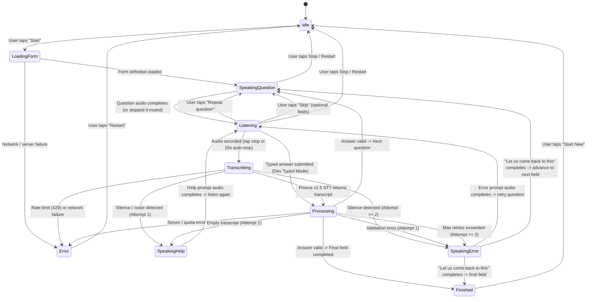

# Solli Conversation Loop Specification

> **Phase:** Phase 8: Voice Question Loop  
> **Status:** Built and verified with unit tests and live speech verification.

---

## 1. State Diagram (Mermaid)

---

## 2. Explicit Transition Table

| Current State (`FROM`) | Trigger Event (`EVENT`) | Next State (`TO`) | Description |
|---|---|---|---|
| `idle` | `START` | `loadingForm` | User taps "தொடங்கு / Start" button (satisfies browser autoplay policy). |
| `loadingForm` | `FORM_LOADED` | `speakingQuestion` | Form definition retrieved from `GET /api/form/pension`. First spoken field selected. |
| `loadingForm` | `FAIL` | `error` | Form loading failure. |
| `speakingQuestion` | `AUDIO_ENDED` / `SKIP_AUDIO` | `listening` | Question audio completes playback (or skipped when `voiceMuted` is true). |
| `speakingQuestion` | `STOP` / `RESTART` | `idle` | Resets conversation, cancels audio playback and requests. |
| `listening` | `RECORDING_STOPPED` | `transcribing` | User taps Stop button or 15-second auto-stop fires. Microphone released. |
| `listening` | `TYPED_SUBMIT` | `processing` | Dev typed test mode: user submits text without microphone or STT call. |
| `listening` | `REPEAT_QUESTION` | `speakingQuestion` | Replays the current question prompt audio. |
| `listening` | `SKIP_FIELD` | `speakingQuestion` / `finished` | Optional field skipped; advances to next question. |
| `transcribing` | `TRANSCRIBE_SUCCESS` | `processing` | Prisma v2.5 STT returned transcript text. |
| `transcribing` | `TRANSCRIBE_SILENCE` | `speakingHelp` / `speakingError` | Blank audio or noise. |
| `transcribing` | `FAIL` | `error` | STT network error or quota exhaustion. |
| `processing` | `ANSWER_VALID` | `speakingQuestion` / `finished` | Extracted and validated; answers updated. Advances or finishes. |
| `processing` | `ANSWER_SILENCE` | `speakingHelp` / `speakingError` | Silence rule evaluated (attempt 1 speaks help, attempt 2 advances). |
| `processing` | `ANSWER_INVALID` | `speakingError` | Validator failed. Speaks error prompt or advances if retries exceeded. |
| `speakingHelp` | `AUDIO_ENDED` | `listening` | Help prompt played; user given another chance to speak. |
| `speakingError` | `AUDIO_ENDED_RETRY` | `listening` | Error prompt played; retrying same question. |
| `speakingError` | `AUDIO_ENDED_ADVANCE` | `speakingQuestion` / `finished` | "Let us come back to this" played; marked as `needsOperatorHelp` and moves on. |
| `finished` | `RESTART` | `idle` | Review list displayed; user can start fresh. |
| `error` | `RESTART` | `idle` | Error box displayed; user can restart. |

---

## 3. Retry and Silence Rules

### Rule 1: Maximum 2 Attempts Per Field
- If a user provides an invalid answer (e.g., 9-digit phone number or letters in a number field):
  - **Attempt 1:** The engine speaks the field's `errorMessage` (or `helpPrompt`) and transitions back to `listening`.
  - **Attempt 2:** The engine speaks the courteous deferral prompt:
    - **Tamil:** *"இதை அப்புறம் பார்க்கலாம். அடுத்த கேள்விக்கு செல்வோம்."*
    - **English:** *"Let us come back to this. Moving to the next question."*
  - The field is marked with `needsOperatorHelp: true` and the loop **advances to the next field**.
  - **The engine never gets stuck in an infinite loop.**

### Rule 2: Silence & Noise Rule
- If the audio recording yields an empty transcript or unintelligible noise:
  - It counts towards the attempt counter.
  - On the first occurrence, the engine plays `helpPrompt` once to guide the applicant.
  - On repeated silence, it triggers the deferral rule and advances.

### Rule 3: Conditional Branching (`dependsOn`)
- Questions with `dependsOn: { field, equals }` are dynamically skipped or evaluated in `POST /api/form/:id/next`.

---

## 4. Credit-Saving Architecture

To protect the strictly limited 5,000 credit budget:

1. **In-Memory Server TTS Cache (`server/ttsCache.js`):**
   - Keyed by `SHA-256(text + voice + language)`.
   - Max capacity of 100 entries with LRU eviction.
   - Sets response header `X-Cache: HIT` or `X-Cache: MISS`.
   - Static form questions and help prompts hit the cache after their first playback. Repeat sessions cost **0 Timbre credits**.
   - **Sensitive Data Bypass:** Any synthesis with `sensitive: true` (e.g. readbacks containing Aadhaar or bank numbers) strictly bypasses caching.

2. **Server Hourly Live Call Guard (`server/creditGuard.js`):**
   - Configurable soft limit via `MAX_LIVE_CALLS_PER_HOUR` (default: 120 calls/hr).
   - Tracks sliding 1-hour external API calls (STT calls + TTS cache misses).
   - If exceeded, returns HTTP `429` with a friendly bilingual operator assistance prompt instead of exhausting credits in runaway loops.

3. **Typed Test Mode (Development & Testing):**
   - Toggleable in `/app` when `import.meta.env.DEV` is true.
   - Bypasses microphone recording and Prisma STT entirely.
   - Combined with "Mute Voice", enables complete form loop testing with **0 external API calls**.

4. **Client-Side Render Guard:**
   - Strict `useRef(inFlight)` flags in `useConversation.js` ensure React re-renders never trigger duplicate or concurrent API calls.
